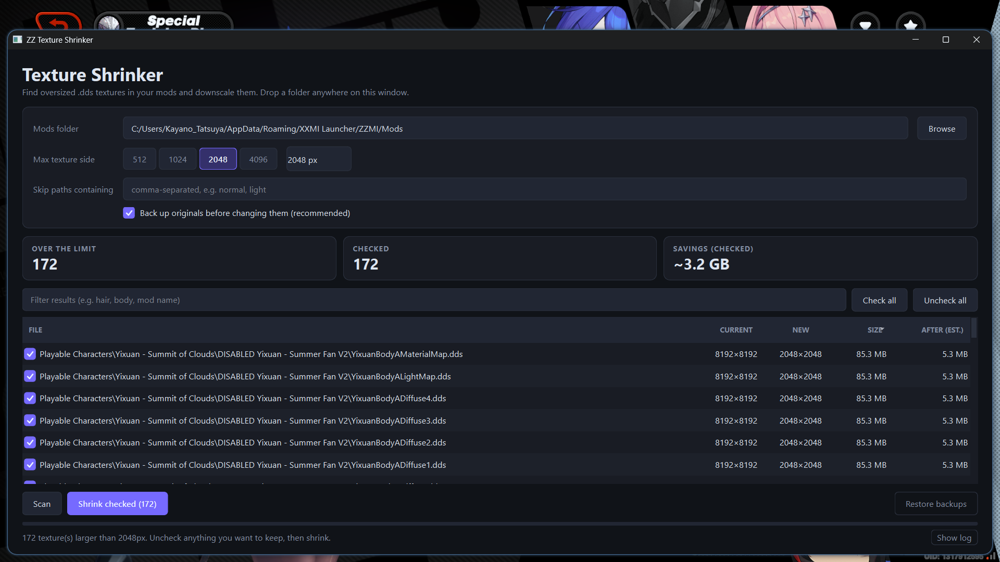

# TexTrim

**A drag-and-drop texture downsizer for game mods. Keeps the original compression format. No installer. Windows now, Linux planned.**



Mod textures are often far larger than they need to be. Big textures eat VRAM, slow down loading, and bloat downloads. TexTrim scans a mod folder and shrinks every oversized texture to a size you choose, while keeping each file's original compression format so the mod still loads correctly.

Built for ZZZ and similar gacha games, and it should work with any game whose mods use DDS textures (the XXMI family: Zenless Zone Zero, Genshin Impact, Honkai: Star Rail, Wuthering Waves, and others). Microsoft's `texconv` is bundled into the exe, so there is nothing else to install.

## Features

- **Drag and drop** a mod folder onto the window and it scans right away
- **Depth search** finds textures in nested subfolders
- **Compression retention:** keeps each file's original format (BC1 to BC7 and other common DDS formats) instead of re-encoding everything to one format
- **Presets by texture size** from 512px to 4096px, plus a custom limit up to 16384px
- **Size limit mode:** textures at or under your limit are left alone, and larger ones are halved until they fit
- **Review before you shrink:** a sortable table with a live filter box, per-row checkboxes, and **Check all / Uncheck all** for the visible rows
- **Savings preview:** estimated size after shrinking, per texture and in total for what you have checked
- **Right-click menu** on any row: Show in folder, Skip this mod from now on, Remove from list
- **Safe by default:** originals are backed up first, failures stay in the list, and you can cancel at any time
- **Restore backups** with one button
- **Remembers** your folder, size, skip list, and window size
- **No installer, no admin rights**

## Example

<!-- Replace with real numbers from your own testing before publishing. -->

| | Before | After (2048px preset) |
|---|---|---|
| Textures | 42 | 42 |
| Total size | 1.8 GB | 600 MB |


## Download

Get the latest build from the [Releases](../../releases) page.

- **Windows:** download `TexTrim.exe` and run it. No install needed.
- **Linux:** planned, with native binaries. Not available yet (see [Known limitations](#known-limitations)).

<!-- When Linux builds exist, use this:
- **Linux:** download the `.AppImage` (or archive), then run:
  ```bash
  chmod +x TexTrim.AppImage
  ./TexTrim.AppImage
  ```
-->

Each release includes a SHA-256 checksum so you can verify your download.

> **Antivirus note:** Unsigned programs from new developers are sometimes flagged by Windows SmartScreen or antivirus software. The full source code is in this repository, and you can build it yourself (see below).

## Usage

1. Open TexTrim and drag your mod folder into the window (or use the **Browse** button). It scans automatically.
2. Pick a preset, or enter a custom size. If you change the size after a scan, press **Scan** again to refresh the list.
3. Review the list. Use the filter box to narrow it down, and uncheck anything you want to leave alone. Right-click a row to skip a whole mod.
4. Leave **Back up originals** ticked (recommended), then click **Shrink checked** and wait for it to finish.
5. Not happy with the result? Click **Restore backups** to put the originals back.

Backups are copied to a folder named `<your mod folder>_texture_backup`, next to the folder you scanned. TexTrim changes files in place, so the backup is your safety net.

**Tip:** always keep a copy of the original mod until you've checked the result in-game.

## Supported formats

- DDS textures (current)
- Compression formats preserved: BC1 to BC7, and other formats that `texconv` can read and write

More formats may be added later. Open an issue if you need one.

## Known limitations

- **Windows only for now.** `texconv` is a Windows tool, so Linux needs a different setup. Native Linux support is planned.
- Only DDS is supported for now
- Shrinking textures lowers image quality, so very small presets may look soft on close-ups. Block-compressed textures are decompressed, resized, and compressed again, which adds a little loss on top of the downscaling.
- Textures are halved until they fit, so the result can end up smaller than your limit. For example, a 3072px texture with a 2048px limit becomes 1536px.
- The savings estimate assumes block-compressed formats, where file size scales with pixel count. Real results can differ slightly.
- Re-encoding BC7 can be slow on large batches
- Some mods expect specific texture sizes, especially normal maps and light maps. Test on one mod first, and use the skip box (for example `normal, light`) to leave those alone.

## Building from source

Requires Python 3.12 (recommended) and the packages in `requirements-qt.txt`.

```bash
pip install -r requirements-qt.txt
python textrim_qt.py
```

On the first shrink, TexTrim downloads `texconv.exe` if it is not already bundled or sitting next to the program.

### Build a standalone exe (Windows)

1. Install Python 3.12 and tick "Add to PATH".
2. Run `build_qt.bat` (PyInstaller) or `build_qt_nuitka.bat` (Nuitka, smaller and often faster to start). The script installs the dependencies, downloads `texconv.exe`, builds the exe, and prints its path and size.

To build a standalone version with Nuitka by hand:

```bat
python -m nuitka --onefile --enable-plugin=pyside6 --windows-console-mode=disable ^
  --assume-yes-for-downloads --include-data-files=texconv.exe=texconv.exe ^
  --noinclude-qt-plugins=tls,printsupport,iconengines ^
  --output-dir=dist_nuitka --output-filename=TexTrim.exe ^
  --product-name="TexTrim" --file-description="TexTrim texture optimizer" ^
  --product-version=1.0.0.0 --file-version=1.0.0.0 ^
  textrim_qt.py
```

The first Nuitka build takes several minutes and may download a C compiler automatically.

### Two front ends, one core (`textrim_core.py`)

| | PySide6 (recommended) | tkinter (lightweight fallback) |
|---|---|---|
| Script | `textrim_qt.py` | `textrim_tk.py` |
| Build | `build_qt.bat` -> `dist\TexTrim.exe` | `build_tk.bat` -> `dist\TexTrim_tk.exe` |
| Nuitka build | `build_qt_nuitka.bat` -> `dist_nuitka\TexTrim.exe` | - |
| Console debug build | `build_qt_debug.bat` | `build_tk_debug.bat` |
| Diagnostics | `diagnose_qt.bat` | `diagnose_tk.bat` |

The tkinter version has the same core logic with a simpler interface and no extra dependencies. It also has a command-line mode:

```bash
python textrim_tk.py "D:/Mods" --max 2048 --dry-run
```

## Troubleshooting

If something crashes, a dialog shows the error and it is saved to `crash.log`. `textrim_startup.log` shows how far startup got. Run `diagnose_qt.bat` and send `diagnose_qt.txt` if you need help.

## Contributing and bug reports

Found a bug or a mod that breaks? Open an issue and include the game, the mod name, and the log or error message (`crash.log` or `diagnose_qt.txt` if you have them).

## Support

If this saved you time or disk space, you can support development on [Ko-fi](https://ko-fi.com/kayano-tatsuya). It's appreciated but never required.

## License

GPLv-3.0. See [LICENSE](LICENSE).

## Third-party software

- [PySide6 / Qt](https://www.qt.io/), LGPL v3
- [DirectXTex / texconv](https://github.com/microsoft/DirectXTex) by Microsoft, MIT (bundled in the Windows build)
- Build tools: [Nuitka](https://nuitka.net/) (Apache-2.0) or [PyInstaller](https://pyinstaller.org/) (GPL-2.0 with a bootloader exception)

This project is not affiliated with or endorsed by any game developer or publisher, or by the XXMI project.
